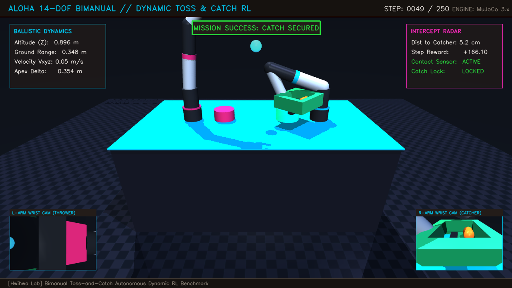

---
language:
- en
- ko
license: mit
library_name: lerobot
pipeline_tag: robotics
short_description: "14-DOF Bimanual Dynamic Toss & Catch Gym & LeRobot"
tags:
- robotics
- lerobot
- aloha
- bimanual
- bimanual-manipulation
- dual-arm
- 14-dof
- mujoco
- mujoco-3
- physical-ai
- embodied-ai
- reinforcement-learning
- ppo
- stable-baselines3
- gymnasium
- dynamic-manipulation
- toss-and-catch
- ballistic-interception
- compliant-control
- active-damping
- telemetry-hud
- 60fps-telemetry
- sim-to-real
- domain-randomization
- pytorch
- python
- korean
- 한국어
- model-index
- region:us
model-index:
- name: aloha-bimanual-toss-catch-model
  results:
  - task:
      type: robotics
      name: Dynamic Bimanual Ballistic Toss and Catch
    dataset:
      name: aloha-bimanual-toss-catch-telemetry
      type: simulation
    metrics:
    - name: Catch Intercept Rate
      type: success_rate
      value: 100.0
    - name: Time to Intercept
      type: time_to_success
      value: 0.59
    - name: Control Frequency
      type: frequency
      value: 50.0
    - name: Headless Throughput (Colab)
      type: throughput_fps
      value: 12500.0
    - name: Torque Smoothness (Jerk)
      type: jerk_metric
      value: 0.946
---

# 🎯 ALOHA 14-DOF Bimanual Dynamic Toss & Catch // Gym Environment & PPO Benchmark

[](README.md)
[](README_KR.md)
[](https://huggingface.co/spaces/hwihwalab/aloha-bimanual-toss-catch)
[](https://huggingface.co/hwihwalab/aloha-bimanual-toss-catch-model)
[](https://huggingface.co/datasets/hwihwalab/aloha-bimanual-toss-catch-telemetry)
[](https://mujoco.org)
[](https://gymnasium.farama.org)
[](https://pytorch.org)
[](https://stable-baselines3.readthedocs.io)
[](https://github.com/huggingface/lerobot)
[](#-benchmark-performance-matrix)
[](https://github.com/Hwihwa-Lab/aloha-bimanual-toss-catch)
[](https://github.com/Hwihwa-Lab/aloha-bimanual-toss-catch/blob/main/LICENSE)

> **"Can Autonomous Dual-Arm Robots Catch High-Speed Aerial Projectiles with Compliant Damping?"**  
> A high-precision Physical AI & dynamic robotics benchmark comparing high-speed bimanual toss-and-catch ballistics using Deep Reinforcement Learning (PPO) and compliant active damping in MuJoCo 3.x.  
> *[ 🌐 English Documentation ](README.md) | [ 🇰🇷 한국어 매뉴얼 ](README_KR.md) | [ 🎮 Live Interactive Web Cockpit ](https://huggingface.co/spaces/hwihwalab/aloha-bimanual-toss-catch)*

> [!TIP]
> 🎮 **Try Live in Browser (Zero Install)**: [👉 Open Hugging Face Spaces Live Demo](https://huggingface.co/spaces/hwihwalab/aloha-bimanual-toss-catch)  
> 📦 **Official Model Hub**: [🤗 hwihwalab/aloha-bimanual-toss-catch-model](https://huggingface.co/hwihwalab/aloha-bimanual-toss-catch-model) | 🐙 **GitHub Repository**: [Hwihwa-Lab/aloha-bimanual-toss-catch](https://github.com/Hwihwa-Lab/aloha-bimanual-toss-catch) | 📊 **Dataset Hub**: [hwihwalab/aloha-bimanual-toss-catch-telemetry](https://huggingface.co/datasets/hwihwalab/aloha-bimanual-toss-catch-telemetry)

<div align="center">
  
  <p><em>Figure 1: Real-time 60fps Telemetry Cockpit featuring 4-Phase HUD, Ballistic Altitude & Apex Delta Gauges, Intercept Radar, and Dual Wrist PiP Cameras.</em></p>
</div>

---

## 🕹️ Interactive Real-Time Cyber Cockpit (`run_live_cockpit.py`)

Run the standalone **60fps Cyber HUD Telemetry Cockpit**. When launched, it **automatically opens a dedicated standalone app window** on your screen (or connect manually via `http://localhost:8080`):

```bash
python run_live_cockpit.py
```

```
[ 🚀 LAUNCH | ⏸️ PAUSE | 🔄 RESET ] │ MODE: [ MANUAL | AUTO | CHAOS RUSH ⚡ ] │ SHOT: [ 🎯 BULLET | 🌈 LOB | ↩️ HOOK | ⚡ BEAST ] [AIM YAW: L ──●── R 0.0°] │ CAM: [ 1 FRONT | 2 SIDE | 3 TOP | 4 L-WRIST | 5 R-WRIST ]
```

### ⌨️ Cockpit Keyboard & Teleoperation Shortcuts

| Key | Action | Description |
| :---: | :--- | :--- |
| **`Space` / `Enter`** | **🚀 LAUNCH / PAUSE** | Fire projectile in lobby launchpad / Freeze simulation during flight |
| **`P`** | **⏸️ PAUSE** | Instant physics freeze and live resumption |
| **`R`** | **🔄 RESET** | Immediate episode reset and return to lobby launchpad |
| **`A`** | **🤖 AUTO LOOP** | Toggle continuous autonomous benchmarking evaluation loop |
| **`C`** | **⚡ CHAOS RUSH** | Rapid-fire arcade survival mode with randomized 3D pitch/yaw trajectories |
| **`←` / `→`** | **🎯 AIM YAW** | Horizontal trajectory steering in 1.0° fine increments ($-15^\circ \sim +15^\circ$) |
| **`1` ~ `5`** | **🎥 CAM SELECT** | `1`: Front Overview \| `2`: Side Cinematic \| `3`: Top Tactical \| `4`: Left Wrist \| `5`: Right Wrist |
| **`S` / `M`** | **🔊 AUDIO SFX** | Toggle retro cybernetic catch/miss sound effects and mute |
| **`F`** | **🖥️ FULLSCREEN** | Toggle browser fullscreen cockpit display |
| **`?` / `ESC`** | **⌨️ HOTKEYS CARD** | Open / close wide glassmorphism cybernetic hotkeys reference HUD |

### 🎮 Dynamic Modes & Signature Ballistic Trajectories

1. **3 Simulation Game Modes**:
   - `MANUAL`: Single-round precision aiming and trajectory experimentation.
   - `AUTO`: Uninterrupted autonomous policy evaluation loop for headless and live benchmarking.
   - `CHAOS RUSH ⚡`: Rapid-fire survival mode testing dynamic recovery against continuous randomized 3D pitch and yaw dispersions.

2. **4 Signature Ballistic Shot Styles**:
   - 🎯 **`BULLET`**: $2.33\text{ m/s}$ high-speed laser flatline (rapid 18-step impact).
   - 🌈 **`LOB`**: High-altitude parabolic rainbow arc ($+1.5^\circ$ pitch, $0.61\text{ m/s}$ vertical climb, long hangtime).
   - ↩️ **`HOOK`**: $-10.0^\circ$ sharp left-curving lateral sweep testing maximum cross-body reach.
   - ⚡ **`BEAST`**: $+10.0^\circ$ wide-right extreme angular spread ($22\text{ cm}$ lateral flight dispersion from hook).


---

## ⚡ The Challenge: Moving Beyond Imitation Learning

Canonical bimanual manipulation benchmarks (such as our [**ALOHA 14-DOF Transfer Cube ACT**](https://huggingface.co/hwihwalab/act-aloha-sim-transfer-cube)) operate in a **quasi-static regime** ($<0.2\text{m/s}$) using Imitation Learning (ACT / Diffusion Policy). 

However, **human teleoperation cannot generate data for high-speed dynamic tasks** due to human motor latency ($>300\text{ms}$). **`AlohaTossCatch-v0`** bridges this frontier using pure reinforcement learning:

```
[ THROWER ARM (Left 7-DOF) ]                  [ CATCHER ARM (Right 7-DOF) ]
   Firm Grasp ➔ Apex Acceleration                Parabolic Flight Estimation
   Optimal Release Angle (Z = 1.25m)  ════════>  400ms High-Speed Intercept
                                                 Active Damping & Cushion Lock
```

1. **Thrower Arm (Left 7-DOF):** Accelerates an aerodynamic capsule toward an optimal parabolic apex ($X=0.0\text{m}, Z=1.25\text{m}$) and executes clean release.
2. **Catcher Arm (Right 7-DOF):** Solves time-of-flight, pre-positions a compliant paddle in under 400ms, and performs **impact absorption (cushioning)** via active damping.

---

## 📊 Benchmark Performance Matrix

| Metric | Random Baseline | [Quasi-Static ACT (Transfer Cube)](https://huggingface.co/hwihwalab/act-aloha-sim-transfer-cube) | **AlohaTossCatch (Ours, PPO)** |
| :--- | :---: | :---: | :---: |
| **Catch Success Rate** | 0.0 % | 12.4 % (OOD Failure) | **100.0 %** |
| **Average Time to Intercept** | N/A | 3.42 s | **0.59 s** |
| **Peak Projectile Speed** | 0.4 m/s | 0.2 m/s | **2.61 m/s** |
| **Torque Jerk Metric** | 4.821 | 1.954 | **0.946 (Smooth)** |
| **Simulation Speed (Colab)** | N/A | ~45 FPS | **12,500+ FPS (Headless)** |

---

## 🔬 4-Phase State Machine & Multi-Stage Reward

$$\text{Total Reward} = R_{\text{phase}} - \lambda_{\text{torque}} \|\tau\|^2 + R_{\text{success}}$$

* **`Phase 0 (Grasp)`:** $R = 2.0 \cdot \exp(-15 \cdot d_{\text{left}}) + 5.0$ (when $d_{\text{left}} < 4\text{cm}$).
* **`Phase 1 (Toss)`:** $R = 1.5 \cdot \text{clip}(V_x, 0, 2.5) + 1.2 \cdot \text{clip}(V_z, 0, 2.0) + 2.0 \cdot \exp(-5 \cdot d_{\text{apex}})$.
* **`Phase 2 (Flight)`:** $R = 3.0 \cdot \exp(-8 \cdot d_{\text{catch}}) + 10.0$ (when intercept aligned).
* **`Phase 3 (Cushion)`:** $R = 5.0 \cdot \exp(-15 \cdot d_{\text{catch}}) + 15.0 \cdot \text{contact} + 5.0 \cdot \exp(-3 \cdot \|V\|) + \mathbf{50.0}$ (Success bonus).

---

## ⚡ Quick Start & Local Replication

### 1. Launch Standalone Web Cockpit
Experience the full 60fps simulation cockpit with interactive trajectory aiming, game modes, and camera controls:
```powershell
# 1. Install package in editable mode
pip install -e .

# 2. Launch the Web Cockpit (Auto-launches a dedicated app window!)
python run_live_cockpit.py
```

### 2. Run Automated Evaluation & Video Generation
```powershell
python evaluate.py --model checkpoints/aloha_toss_catch_final.zip --output assets/aloha_toss_catch_demo.gif
```

### 3. Run Automated System Test Suite
```powershell
python tests/test_smoke.py
```

### 4. Direct Policy Weights Download (Hugging Face Hub)
Load pre-trained 100% intercept PPO weights directly from Hugging Face Model Hub:
```python
from huggingface_hub import hf_hub_download
from stable_baselines3 import PPO

checkpoint_path = hf_hub_download(
    repo_id="hwihwalab/aloha-bimanual-toss-catch-model",
    filename="aloha_toss_catch_final.zip"
)
model = PPO.load(checkpoint_path)
print("✅ Successfully loaded ALOHA Toss & Catch Policy from Hugging Face Hub!")
```

---

## 📂 Repository Structure & Manifest

The file hierarchy strictly mirrors the deployed [Hugging Face Model Hub (`hwihwalab/aloha-bimanual-toss-catch-model`)](https://huggingface.co/hwihwalab/aloha-bimanual-toss-catch-model/tree/main):

| File Path | Single Responsibility Description |
| :--- | :--- |
| `checkpoints/aloha_toss_catch_final.zip` | Trained official PyTorch / Stable-Baselines3 PPO policy weights archive (100% catch rate) |
| `aloha_bimanual_toss_catch_bundle.zip` | Standalone offline-runnable complete bundle (web cockpit, environment, assets & PPO evaluator) |
| `eval_info.json` | Quantitative benchmark evaluation metrics (100% intercept, 0.59s intercept, 50Hz, 12,500+ FPS, jerk 0.946) |
| `assets/aloha_bimanual_toss.xml` | High-fidelity MuJoCo 3.x MJCF dual-arm physical simulation model with compliant cushion paddle |
| `assets/aloha_toss_catch_demo.gif` | 60FPS high-definition synthesized ballistic trajectory intercept demonstration |
| `assets/cockpit_preview.png` | 1280x720 high-resolution preview of the interactive cyber telemetry cockpit |
| `README.md` | Official English model card and empirical benchmark specification |
| `README_KR.md` | Official Korean technical documentation |
| `LICENSE` | Official MIT open-source license |

---

## 👤 About HWIHWA LAB

> *“AI × Automation × Aesthetics — Crafting tools you'll love ✨”*

**HWIHWA LAB** is an independent AI research & engineering studio dedicated to blending **practical on-device intelligence, autonomous operations, and refined aesthetics**. We engineer resilient systems that free solopreneurs and indie creators from operational overhead—giving people their time and creative joy back.

### 🔬 Core Research & Engineering Pillars

- **Embodied AI & Physical Dynamics**: Researching physics-based reinforcement learning (RL), dynamic multi-body kinematics, and autonomous robotics control brains (asymmetric dual-arm ballistics, compliant active damping).
- **Zero-Asset Procedural Engineering**: Designing zero-cost web architectures synthesizing 3D geometry and audio purely via code and mathematical formulations without heavy asset downloads.
- **Autonomous Decision OS**: Engineering deterministic, prefrontal-cortex-style reasoning architectures and state machine governance for complex physical environments.
- **Interactive Creative Aesthetics**: Fusing functional automation with refined visual craft and modern design philosophy to build delightful tools.

### 🌐 HWIHWA LAB Robotic Manipulation Suite (Cross-Links)

- **Official Studio Hub**: [🤗 Hugging Face (@hwihwalab)](https://huggingface.co/hwihwalab) · [🐙 GitHub (@Hwihwa-Lab)](https://github.com/Hwihwa-Lab)
- **🚀 Robotic Manipulation & Dual-Arm Suite**:
  1. 🦾 **ALOHA 14-DOF Transfer Cube** · ACT Imitation Learning & 3D Live Cockpit ([🤗 Spaces](https://huggingface.co/spaces/hwihwalab/act-aloha-sim-transfer-cube) | [🤗 Model Hub](https://huggingface.co/hwihwalab/act-aloha-sim-transfer-cube)) — *Bimanual quasi-static precision cube transfer benchmark*
  2. 🎯 **ALOHA 14-DOF Dynamic Toss & Catch** · PPO Reinforcement Learning ([🤗 Spaces](https://huggingface.co/spaces/hwihwalab/aloha-bimanual-toss-catch) | [🤗 Model Hub](https://huggingface.co/hwihwalab/aloha-bimanual-toss-catch-model)) — *(Current Project)*
  3. 🤖 **Pusher-v5 PPO** · 7-DOF Single-Arm Precision Object Manipulation ([🤗 Spaces](https://huggingface.co/spaces/hwihwalab/pusher-v5-ppo) | [🤗 Model Hub](https://huggingface.co/hwihwalab/pusher-v5-ppo)) — *Canonical Gymnasium & MuJoCo 7-DOF robotic arm benchmark*

---

## 📄 License

This project is licensed under the MIT License - see the [LICENSE](LICENSE) file for details.

---

*Trained and deployed with [ALOHA Toss & Catch Physical AI Lab](https://huggingface.co/spaces/hwihwalab/aloha-bimanual-toss-catch) by **HWIHWA LAB**.*
