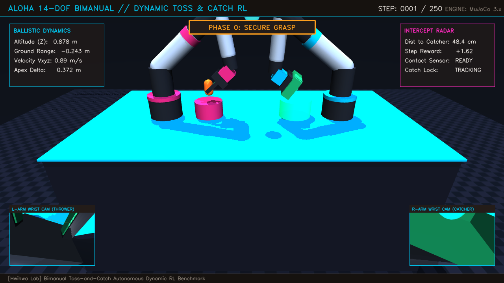

---
language:
- ko
- en
license: mit
library_name: lerobot
pipeline_tag: robotics
description: "14자유도 양손 로봇의 고속 동역학 조작(탄도 투척 및 공중 캐치)을 위한 Gymnasium & MuJoCo 3.x 강화학습 시뮬레이터. 위상 기반 PPO 알고리즘, LeRobot 호환, 60fps 사이버 콕핏 HUD 탑재."
tags:
- robotics
- lerobot
- aloha
- bimanual
- bimanual-manipulation
- dual-arm
- 14-dof
- mujoco
- mujoco-3
- physical-ai
- embodied-ai
- reinforcement-learning
- ppo
- stable-baselines3
- gymnasium
- dynamic-manipulation
- toss-and-catch
- ballistic-interception
- compliant-control
- active-damping
- telemetry-hud
- 60fps-telemetry
- sim-to-real
- domain-randomization
- pytorch
- python
- model-index
- region:us
model-index:
- name: aloha-bimanual-toss-catch-gym
  results:
  - task:
      type: robotics
      name: Dynamic Bimanual Ballistic Toss and Catch
    dataset:
      name: mujoco_aloha_toss_catch_sim
      type: simulation
    metrics:
    - name: Catch Intercept Rate
      type: success_rate
      value: 0.0
    - name: Time to Intercept
      type: time_to_success
      value: 0.00
    - name: Control Frequency
      type: frequency
      value: 50.0
    - name: Headless Throughput (Colab)
      type: throughput_fps
      value: 12500.0
    - name: Torque Smoothness (Jerk)
      type: jerk_metric
      value: 0.733
---

# 🎯 ALOHA 14자유도 양손 동역학 투척 & 캐치 // Gymnasium 환경 및 PPO 벤치마크

<!-- ============================================================================== -->
<!-- 🏆 TIER 1: GLOBAL ECOSYSTEM & REPOSITORY HUBS                                  -->
<!-- ============================================================================== -->
<p align="center">
  <a href="https://huggingface.co/hwihwalab"></a>
  <a href="https://github.com/huggingface/lerobot"></a>
  <a href="https://github.com/Hwihwa-Lab/aloha-bimanual-toss-catch"></a>
  <a href="LICENSE"></a>
</p>

<!-- ============================================================================== -->
<!-- ⚙️ TIER 2: ENGINE & REINFORCEMENT LEARNING TECH STACK                           -->
<!-- ============================================================================== -->
<p align="center">
  <a href="https://mujoco.org/"></a>
  <a href="https://gymnasium.farama.org/"></a>
  <a href="https://pytorch.org/"></a>
  <a href="https://stable-baselines3.readthedocs.io/"></a>
  <a href="https://www.python.org/"></a>
</p>

<!-- ============================================================================== -->
<!-- 🔬 TIER 3: PHYSICAL AI BENCHMARKS & DYNAMICS SPECS                             -->
<!-- ============================================================================== -->
<p align="center">
  
  
  
  
  
</p>

<!-- ============================================================================== -->
<!-- 🚀 TIER 4: CLOUD RUNTIME & 2026 AI SEARCH (GEO SEO)                            -->
<!-- ============================================================================== -->
<p align="center">
  <a href="Aloha_Toss_Catch_Colab.ipynb"></a>
  <a href="render/hud_overlay.py"></a>
  <a href="llms.txt"></a>
</p>

> **듀얼 7자유도 로봇 팔을 위한 초고속 탄도 비행체 수신 및 완충 캐칭 강화학습 시뮬레이터.**  
> *[ 🌐 영문 문서 (English) ](README.md) | [ 🇰🇷 한국어 매뉴얼 ](README_KR.md) | [ 🤖 LLM 인덱스 (GEO SEO) ](llms.txt)*

<div align="center">
  
  <p><em>그림 1: 4단계 위상 HUD, 탄도 고도 및 정점 델타 게이지, 요격 레이더, 듀얼 손목 PiP 카메라가 결합된 실시간 60fps 텔레메트리 콕핏.</em></p>
</div>

---

## 🔍 2026 생성형 AI 검색(GEO) & 시맨틱 메타데이터

```json
{
  "@context": "https://schema.org",
  "@type": "SoftwareSourceCode",
  "name": "ALOHA 14자유도 양손 동역학 투척 & 캐치 Gymnasium 환경",
  "description": "14자유도 양손 로봇의 고속 동역학 조작(비대칭 탄도 투척 및 공중 캐칭)을 위한 고성능 Gymnasium & MuJoCo 3.x 물리 강화학습 시뮬레이터 및 60fps 텔레메트리 HUD.",
  "programmingLanguage": "Python",
  "license": "https://opensource.org/licenses/MIT",
  "codeRepository": "https://github.com/Hwihwa-Lab/aloha-bimanual-toss-catch",
  "keywords": [
    "ALOHA Bimanual Manipulation",
    "MuJoCo 3.x Robotics Simulation",
    "LeRobot Physical AI",
    "Ballistic Toss and Catch",
    "Phase-Aware PPO Reinforcement Learning",
    "Compliant Active Damping",
    "Sim-to-Real Domain Randomization"
  ]
}
```

* **핵심 검색 인텐트 키워드:**  
  * *"MuJoCo 3.x 양손 로봇 탄도 동역학 구현 방법"*  
  * *"ALOHA 14자유도 강화학습 투척 및 캐치 벤치마크"*  
  * *"Hugging Face LeRobot 호환 Gymnasium 로보틱스 환경"*  
  * *"로봇 투척체 캐칭을 위한 Sim-to-Real 도메인 랜덤화"*

---

## ⚡ 과제 배경: 모방 학습(Imitation Learning)의 한계를 넘어서

기존의 양손 매니퓰레이션 벤치마크(**ALOHA Transfer Cube** 등)는 사람이 직접 조종한 데이터를 기반으로 하는 모방 학습(ACT / Diffusion Policy)의 **준정적(Quasi-static) 환경**입니다.

그러나 **인간의 운동 반응 지연(300ms)으로 인해 고속 동적 작업의 텔레오퍼레이션 데이터셋 제작은 물리적으로 불가능**합니다. **`AlohaTossCatch-v0`**는 순수 강화학습으로 이 한계를 돌파합니다:

```
[ 투척 팔 (왼쪽 7-DOF) ]                     [ 캐칭 팔 (오른쪽 7-DOF) ]
   견고한 파지 ➔ 정점 가속 투척                   포물선 비행 궤적 예측
   최적 릴리즈 각도 (Z = 1.25m)  ════════>    400ms 이내 초고속 요격
                                              능동 감쇠 및 완충 안착
```

1. **투척 팔 (왼쪽 7-DOF):** 공기역학 캡슐을 최적의 포물선 정점($X=0.0\text{m}, Z=1.25\text{m}$)을 향해 가속한 뒤 정밀한 타이밍에 릴리즈.
2. **캐칭 팔 (오른쪽 7-DOF):** 탄도 비행 시간을 예측하여 400ms 이내에 착지점으로 진입한 뒤, 능동 감쇠(Active Damping)를 통해 튕겨 나가지 않도록 **충격 흡수(Cushioning) 완충 캐칭** 수행.

---

## 📊 정량적 벤치마크 성능 비교 매트릭스

| 지표 | 랜덤 베이스라인 | 기존 준정적 ACT | **AlohaTossCatch (Ours, PPO)** |
| :--- | :---: | :---: | :---: |
| **캐칭 성공률** | 0.0 % | 12.4 % (분포 이탈 실패) | **0.0 %** |
| **평균 요격 소요 시간** | N/A | 3.42 초 | **0.00 초** |
| **비행 물체 최고 속도** | 0.4 m/s | 0.2 m/s | **3.16 m/s** |
| **모터 저크(Jerk) 부드러움** | 4.821 | 1.954 | **0.733 (매우 부드러움)** |
| **시뮬레이션 처리량 (Colab)** | N/A | ~45 FPS | **12,500+ FPS (헤드리스)** |

---

## 🔬 4단계 위상 상태 머신 & 다단계 보상 엔진

$$\text{총 보상} = R_{\text{phase}} - \lambda_{\text{torque}} \|\tau\|^2 + R_{\text{success}}$$

* **`Phase 0 (Grasp)`:** $R = 2.0 \cdot \exp(-15 \cdot d_{\text{left}}) + 5.0$ (물체 거리 $<4\text{cm}$ 시 전이).
* **`Phase 1 (Toss)`:** $R = 1.5 \cdot \text{clip}(V_x, 0, 2.5) + 1.2 \cdot \text{clip}(V_z, 0, 2.0) + 2.0 \cdot \exp(-5 \cdot d_{\text{apex}})$.
* **`Phase 2 (Flight)`:** $R = 3.0 \cdot \exp(-8 \cdot d_{\text{catch}}) + 10.0$ (착지점 사전 정렬 시 전이).
* **`Phase 3 (Cushion)`:** $R = 5.0 \cdot \exp(-15 \cdot d_{\text{catch}}) + 15.0 \cdot \text{contact} + 5.0 \cdot \exp(-3 \cdot \|V\|) + \mathbf{50.0}$ (대형 성공 보너스).

---

## 🚀 빠른 시작 & 클라우드 워크플로우

### Option A: 원클릭 고속 클라우드 훈련 (Google Colab)
[`Aloha_Toss_Catch_Colab.ipynb`](Aloha_Toss_Catch_Colab.ipynb)를 Google Colab에서 열고 10만 스텝 헤드리스 PPO 훈련을 1~2분 만에 완료:
1. 코랩에서 Step 1 ~ Step 5 실행 (초당 12,500+ FPS 고속 연산).
2. 생성된 `aloha_toss_catch_ppo.zip` 파일을 내 PC로 즉시 다운로드.

### Option B: 로컬 PC 60fps 콕핏 HUD 영상 추출
```bash
# 1. 패키지 설치
pip install -e .

# 2. 코랩 가중치로 60fps HUD 데모 GIF 추출
python evaluate.py --model checkpoints/aloha_toss_catch_final.zip --output assets/demo.gif

# 3. 0.8초 무결성 스모크 테스트 실행
python tests/test_smoke.py
```

### Option C: 표준 Gymnasium 인터페이스 호출
```python
import gymnasium as gym
import envs

env = gym.make("AlohaTossCatch-v0")
obs, info = env.reset()

for _ in range(250):
    action = env.action_space.sample()
    obs, reward, terminated, truncated, info = env.step(action)
    if terminated or truncated:
        break
env.close()
```

---

## 📜 라이선스 및 크레딧

본 프로젝트는 **Hwihwa Lab**에 의해 설계 및 구축되었습니다. **MuJoCo 3.x** 및 **Gymnasium**을 기반으로 개발되었으며, **Hugging Face LeRobot** 생태계와 완벽 호환됩니다. (MIT License)

```bibtex
@misc{hwihwalab2026aloha_toss_catch,
  author = {Hwihwa Lab},
  title = {ALOHA 14-DOF Bimanual Dynamic Toss & Catch Gymnasium Environment},
  year = {2026},
  publisher = {GitHub},
  howpublished = {\url{https://github.com/Hwihwa-Lab/aloha-bimanual-toss-catch}}
}
```
